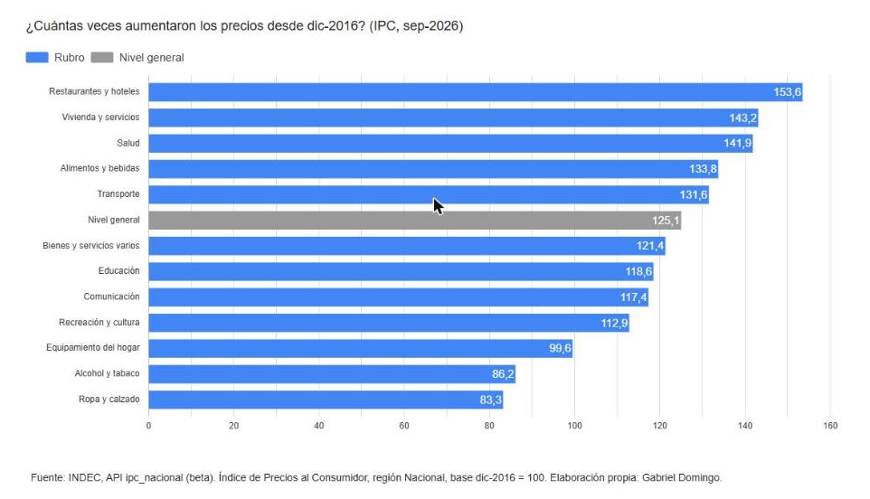

# IPC por rubro con la API del INDEC

Cuánto aumentó cada rubro del IPC desde diciembre de 2016 (base del índice), con datos de la [API del INDEC](https://api.indec.gob.ar/), que salió en noviembre de 2026 y todavía está en beta.



## Qué hace

`ipc_rubros.py` consulta el dataset `ipc_nacional`, busca el último mes publicado y se queda con el nivel general y las 12 divisiones COICOP (región Nacional, índice base dic-2016 = 100). Guarda todo en `ipc_rubros_desde_2016.csv`, que es lo que uso en Looker Studio para el gráfico.

| Columna | Qué es |
|---|---|
| `codigo` | Código del rubro (`0` = nivel general, `01` a `12` = divisiones) |
| `rubro` / `rubro_corto` | Nombre que devuelve la API y una versión corta para el gráfico |
| `tipo` | `Nivel general` o `Rubro` |
| `indice` | Valor del índice en el último mes |
| `veces` | Cuántas veces se multiplicó el precio (`indice / 100`) |
| `aumento_pct` | Aumento acumulado en % (`indice - 100`) |
| `periodo` | Mes del dato (AAAA-MM) |

## Cómo correrlo

1. Sacar un token gratis en [api.indec.gob.ar](https://api.indec.gob.ar/) (te registrás y lo generás desde el perfil).
2. Copiar `.env.example` a `.env` y pegar el token.
3. Instalar dependencias y correr:

```
pip install -r requirements.txt
python ipc_rubros.py
```

## Notas

- La API devuelve como mucho 1000 filas por consulta, el script pagina solo.
- Si te pasás del límite de consultas devuelve 429; el script espera y reintenta.
- Como está en beta, los nombres de campos pueden cambiar.

Fuente de los datos: INDEC.
